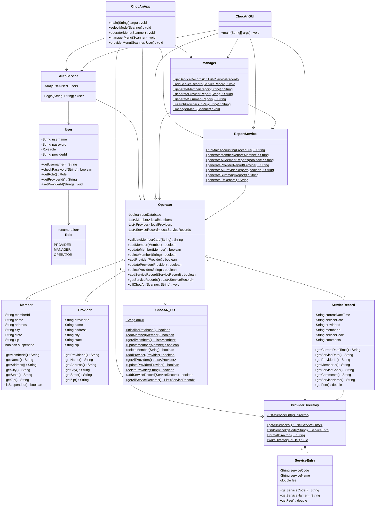

# Chocoholics Anonymous (ChocAn) — CS-200 Final Project

**Team:** CodeJutsu (Team 15)  
**Members:** Simeon, Daniel, Cameron, Jackson, Teal'c

## Project Mission
**Chocoholics Anonymous (ChocAn)** is an organization dedicated to helping people addicted to chocolate in all its glorious forms. For a monthly fee, members receive unlimited consultations and treatments with health care professionals (dietitians, internists, and exercise experts) using a nine-digit member card at provider terminals.

The mission of this project is to develop a reliable, efficient software system and terminal interface for ChocAn—supporting both **Local Persistent Storage Mode** and **Neon PostgreSQL Cloud Database Mode**—to support the organization's core operations:
- **Provider Services:** Validating 9-digit member cards (`Validated`, `Invalid number`, `Member suspended`), recording health care consultations/services with 6-digit service code verification and fee lookup, and requesting/saving the alphabetical Provider Directory.
- **Operator Management:** Maintaining accurate member and provider records (adding, updating, and deleting profiles with ChocAn field length validations).
- **Accounting Procedure & Managerial Reporting:** Running the Friday Midnight Main Accounting Procedure and generating individual Member Reports (`<MemberName>_<Date>.txt`), Provider Reports (`<ProviderName>_<Date>.txt`), Accounts Payable Summary Reports (`Summary_Report_<Date>.txt`), and Electronic Funds Transfer (`EFT_Data_<Date>.txt`) files.

---

## Team Roles & Class Author Attribution
- **Simeon (Backend & Database):** `ChocAN_DB.java`, `AuthService.java`, backend integration, and persistent data storage (Local & Neon PostgreSQL Cloud DB).
- **Daniel (Frontend & UML):** `ChocAnApp.java`, `ChocAnGUI.java`, `User.java`, `Role.java`, terminal interface design, and final UML Class Diagram.
- **Jackson (Provider Features):** `ProviderDirectory.java`, `ServiceEntry.java`, `ServiceRecord.java`, member validation, and provider billing workflows.
- **Teal'c (Operator Features):** `Operator.java`, `Member.java`, `Provider.java`, member and provider record management.
- **Cameron (Manager Features):** `Manager.java`, `ReportService.java`, `ManagerTest.java`, Main Accounting Procedure, Member Reports, Provider Reports, Accounts Payable Summary Report, and EFT data generation.

---

## How to Compile and Run

### Prerequisites
- **Java Development Kit (JDK):** Java 17 or higher
- **PostgreSQL JDBC Driver:** Included at `lib/postgresql-42.7.13.jar`

### 1. Compile the Project
From the project root directory (`CS-200 Final Project`):

**Windows (PowerShell / Command Prompt):**
```powershell
javac -cp "lib/postgresql-42.7.13.jar;src" -d "out/production/CS-200 Final Project" src/*.java
```

**macOS / Linux:**
```bash
javac -cp "lib/postgresql-42.7.13.jar:src" -d "out/production/CS-200 Final Project" src/*.java
```

### 2. Run the Command-Line Terminal (`ChocAnApp`)
```powershell
java -cp "lib/postgresql-42.7.13.jar;out/production/CS-200 Final Project" ChocAnApp
```

### 3. Run the Graphical User Interface (`ChocAnGUI` — Optional Extra Credit)
You can type `gui` at the command-line login prompt, or launch the GUI directly:
```powershell
java -cp "lib/postgresql-42.7.13.jar;out/production/CS-200 Final Project" ChocAnGUI
```

### Test Credentials
| Role | Username | Password | Associated ID / Notes |
| :--- | :--- | :--- | :--- |
| **Operator** | `operator1` | `1984` | Full Member & Provider CRUD |
| **Manager** | `manager1` | `fishes` | Main Accounting Procedure, Member/Provider/Summary/EFT Reports |
| **Provider** | `provider1` | `HotPotato` | Active Provider `111222333` (Dr. Sweet Tooth) |
| **Provider** | `provider2` | `CocoaCare` | Active Provider `444555666` (Choc Care Clinic) |
| **Provider ID Login** | `111222333` | `111222333` | Direct 9-digit Provider Number login |

---

## Final UML Class Diagram


